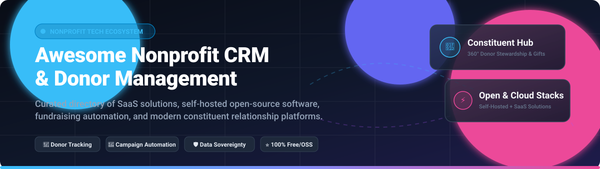
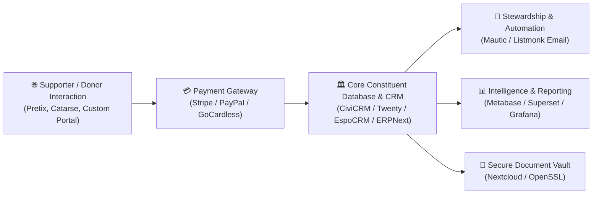

# 🎗️ Awesome Nonprofit CRM & Donor Management

**A carefully curated directory of enterprise SaaS solutions, hosted platforms, and self-hosted open-source software for Nonprofit Customer Relationship Management (CRM), donor stewardship, gift management, fundraising automation, and constituent intelligence.**

*Empowering 501(c)(3) charities, international NGOs, foundations, civic tech developers, and social impact teams with transparent, data-sovereign constituent management stacks.*

---

## 📑 Table of Contents
- [🌐 Sector Overview & Market Dynamics](#-sector-overview--market-dynamics)
- [☁️ SaaS & Hosted Platforms](#️-saas--hosted-platforms)
- [💻 Open-Source GitHub Projects](#-open-source-github-projects)
- [🧩 Specialized Open-Source Components & Utilities](#-specialized-open-source-components--utilities)
- [🏗️ Recommended Architectural Stacks](#️-recommended-architectural-stacks)
- [🤝 How to Contribute](#-how-to-contribute)
- [⚖️ Disclaimer & Compliance](#️-disclaimer--compliance)

---

## 🌐 Sector Overview & Market Dynamics

The global nonprofit CRM and donor management software market was valued between **$3.2B and $4.76B in 2025** and is projected to expand to **~$4.95B in 2026**, registering a compound annual growth rate (CAGR) of 8–11%. The sector is **moderately fragmented** rather than a winner-take-all monopoly: while giant enterprise incumbents (such as Salesforce and Blackbaud) command major universities and large foundations, thousands of mid-sized and grassroots charitable organizations rely on specialized, accessible SaaS providers (Bloomerang, Givebutter, Neon One) and privacy-focused, self-hosted open-source ecosystems (CiviCRM, Twenty, ERPNext).

---

## ☁️ SaaS & Hosted Platforms

The table below summarizes leading hosted and SaaS nonprofit CRM solutions. Entries are sorted in **descending order by company scale** (estimated market valuation / parent enterprise revenue).

| 🏢 Platform | 💰 Company Scale (Revenue / Valuation) | 🏷️ Starting Pricing (Specific Tier) | 🎁 Free Tier Limit / Free Trial Details | 🎯 Key Focus & Core Strengths |
| :--- | :--- | :--- | :--- | :--- |
| **[Salesforce Nonprofit Cloud](https://www.salesforce.com/nonprofit/)** | **~$41.5B ARR / ~$200B+ MCap** (Public: `CRM`) | **$60/user/month** (Nonprofit Cloud Enterprise after donated seats) | **10 free Enterprise licenses forever** via Power of Us Program; 30-day full-feature trial | Enterprise CRM, custom donor 360°, grantmaking, omni-channel automation, and constituent engagement |
| **[Blackbaud Raiser's Edge NXT](https://www.blackbaud.com/products/blackbaud-raisers-edge-nxt)** | **~$1.15B ARR / ~$2.5B–$3.7B MCap** (Public: `BLKB`) | **$4,000/year (~$333/month)** starting tier | **No permanent free tier; 30-day trial for select add-on modules** (Evaluation via guided demo only) | Established institutional fundraising, major gift pipelines, endowment analytics, and university donor tracking |
| **[Virtuous](https://virtuous.org/)** | **~$600M Valuation** (~$22M ARR; Private) | **$400/month** (Starting Platform Tier for orgs under $5M budget) | **No permanent free tier; 14-day guided sandbox demo** upon sales consultation | Responsive fundraising, dynamic gift suggestions, donor behavior signals, and automated donor journeys |
| **[Classy (GoFundMe Pro)](https://www.classy.org/)** | **~$54M ARR / Subsidiary of GoFundMe** (Private) | **$299/month + transaction fee** (Standard plan) | **No permanent free tier; 14-day interactive demo environment** on consultation | Peer-to-peer campaigns, recurring donation pages, ticketed galas, and digital fundraising campaigns |
| **[Bloomerang](https://bloomerang.com/)** | **~$35M–$45M ARR** (Private equity backed) | **$125/month** (Standard CRM tier for up to 1,000 constituent records) | **No permanent free tier; 14-day trial available** via representative-assisted onboarding | Donor retention analytics, donor engagement scoring, gift entry workflows, and integrated email marketing |
| **[DonorPerfect](https://www.donorperfect.com/)** | **~$27.5M–$42.5M ARR** (SofterWare Inc.; 100% Employee-Owned) | **$99/month** (Lite tier for up to 1,000 records) | **No permanent free tier; 14-day trial sandbox** upon product demonstration | Comprehensive gift and pledge tracking, automated receipts, grant lifecycle management, and board reports |
| **[Neon CRM](https://neonone.com/)** | **~$20M–$28M ARR** (Neon One; Private) | **$99/month** (Essentials plan for orgs with under $100K annual fundraising) | **No permanent free tier; 14-day trial account** with guided sales tour | All-in-one membership management, event ticketing, volunteer logging, and relational donation tracking |
| **[Givebutter](https://givebutter.com/)** | **~$300M Valuation** (~$15M ARR; Private) | **$0/month platform fee** (100% free with donor tipping enabled; Plus starts at $29/mo) | **Free forever plan with unlimited contacts, donations, and campaigns** (Supported by optional donor tips; 3% platform fee only if tipping is disabled) | Modern social fundraising, embeddable donation forms, live auctions, Venmo/Apple Pay giving, and built-in donor CRM |
| **[Kindful](https://kindful.com/)** | **~$10M ARR** (Bloomerang Subsidiary; Private) | **$119/month** (Starting tier for up to 1,000 contacts) | **No permanent free tier; 14-day trial period** coordinated via demo | Intuitive donor database, automated donor receipts, campaign landing pages, and third-party accounting sync |
| **[Little Green Light](https://www.littlegreenlight.com/)** | **~$1.7M–$2.5M ARR** (Privately held / Independent) | **$45/month** (Starting tier for up to 2,500 constituent records) | **30-day unrestricted free trial** (Full feature access with no credit card required) | Affordable donor tracking, mail merges, volunteer management, gift acknowledgment, and annual giving reports |

---

## 💻 Open-Source GitHub Projects

Explore the top open-source CRM and donor management software repos. Repositories are sorted in **descending order by GitHub star count** with live social stargazer badges.

| 📦 Repository | ⭐ GitHub Stars | 📜 License | 🛠️ Tech Stack | 💡 Focus & Description |
| :--- | :---: | :---: | :---: | :--- |
| **[Twenty](https://github.com/twentyhq/twenty)** |  | AGPL-3.0 | TypeScript, React, NestJS, PostgreSQL | Modern extensible open-source CRM framework featuring custom relational entities, donor schemas, GraphQL APIs, and workflow automations. |
| **[ERPNext](https://github.com/frappe/erpnext)** |  | GPL-3.0 | Python, JavaScript, MariaDB, Redis | Enterprise resource planning with a dedicated Nonprofit Domain module tracking donors, grant applications, membership dues, and fund accounting. |
| **[Directus](https://github.com/directus/directus)** |  | BSL-1.1 | TypeScript, Node.js, Vue.js, SQL | Real-time headless CMS and data API engine perfect for building custom donor dashboards, donation portals, and volunteer registries on any SQL database. |
| **[Nextcloud Server](https://github.com/nextcloud/server)** |  | AGPL-3.0 | PHP, Vue.js, MySQL / PostgreSQL | Self-hosted collaboration and cloud file storage for organizing confidential grant proposals, tax exemption documents, and board minutes. |
| **[Mautic](https://github.com/mautic/mautic)** |  | GPL-3.0 | PHP, Symfony, MySQL | Open-source marketing automation platform powering multi-channel donor stewardship, drip nurturing, automated renewal reminders, and campaign attribution. |
| **[HumHub](https://github.com/humhub/humhub)** |  | AGPL-3.0 | PHP, Yii 2, MariaDB | Flexible open-source social network and intranet solution for NGO community hubs, volunteer networking, and supporter spaces. |
| **[SuiteCRM](https://github.com/salesagility/SuiteCRM)** |  | AGPL-3.0 | PHP, Angular, MySQL | Enterprise-grade SugarCRM successor with customizable constituent tracking modules, pledge workflows, and reporting pipelines. |
| **[LimeSurvey](https://github.com/LimeSurvey/LimeSurvey)** |  | GPL-2.0 | PHP, JavaScript, MySQL / PostgreSQL | Self-hosted survey system for measuring donor satisfaction, volunteer program feedback, impact evaluations, and community assessments. |
| **[EspoCRM](https://github.com/espocrm/espocrm)** |  | AGPL-3.0 | PHP, Backbone.js, MySQL | Lightweight, lightning-fast CRM with dynamic entity builder ideal for creating custom donor record schemas, gift tracking, and email templates. |
| **[Pretix](https://github.com/pretix/pretix)** |  | AGPL-3.0 | Python, Django, PostgreSQL | Feature-packed open-source event ticketing and attendee management engine for nonprofit charity galas, fundraisers, and community conferences. |
| **[Corteza](https://github.com/cortezaproject/corteza)** |  | Apache-2.0 | Go, Vue.js, PostgreSQL | Low-code, 100% open-source alternative to Salesforce for building customized constituent workflows, donor databases, and reporting consoles. |
| **[Catarse](https://github.com/catarse/catarse)** |  | MIT | Ruby on Rails, Mithril.js, PostgreSQL | Proven open-source crowdfunding and monthly recurring pledge platform with flexible payment gateway integrations. |
| **[CiviCRM Core](https://github.com/civicrm/civicrm-core)** |  | AGPL-3.0 | PHP, MySQL, CMS Integrations | The premier dedicated open-source nonprofit CRM powering 10,000+ organizations. Offers native contribution tracking, memberships, case management, and grants. |
| **[Houdini](https://github.com/HoudiniProject/houdini)** |  | AGPL-3.0 | Ruby on Rails, React, PostgreSQL | Multi-tenant fundraising and online donation platform with Stripe integration, pledge tracking, and customizable fundraising pages. |
| **[Donazy](https://github.com/kodingworks/donazy)** |  | AGPL-3.0 | PHP, Laravel, MySQL | Clean open-source donation management and community fundraising tool built for local initiatives and grassroots charities. |
| **[NationForge Community](https://github.com/programozas-kft/nationforge-community)** |  | AGPL-3.0 | PHP, Laravel 12, Livewire | Civic CRM and community platform designed for NGOs, featuring constituent profiles, gift logging, email blasts, and granular role permissions. |
| **[Grasruts](https://github.com/grasruts/grasruts)** |  | MIT | JavaScript, Node.js, MongoDB | Open-source crowdfunding and grassroots campaign toolkit for community organizers and social causes. |

---

## 🧩 Specialized Open-Source Components & Utilities

- **🏢 [Odoo Nonprofit Donation Management Module](https://apps.odoo.com/apps/modules/19.0/nonprofit_donation_mgmt_pro)** — Enterprise Odoo extension for RFM donor segmentation, tax receipts, recurring pledges, and grant budgeting.
- **💳 Payment Processing Integration SDKs** — [Stripe SDKs](https://github.com/stripe), [PayPal REST SDK](https://github.com/paypal), and [GoCardless](https://github.com/gocardless) for automated direct debit and credit card donation processing.
- **✉️ Transactional & Bulk Email Engines** — [Listmonk](https://github.com/knadh/listmonk) and [phpList](https://github.com/phpList/phplist3) for high-deliverability donor newsletters and tax receipt distributions.
- **📊 Analytics & Donor Dashboards** — [Metabase](https://github.com/metabase/metabase), [Apache Superset](https://github.com/apache/superset), and [Grafana](https://github.com/grafana/grafana) for visualizing donor cohort retention, lifetime value (LTV), and giving trends.

---

## 🏗️ Recommended Architectural Stacks

Nonprofits building independent, sovereign infrastructure can assemble these production-tested open-source components:

1. **Constituent & Gift Tracking**: Deploy **CiviCRM** or **Twenty** paired with PostgreSQL/MySQL for 360-degree constituent profiles.
2. **Fund Accounting**: Connect **ERPNext** or **Odoo** for compliant double-entry fund accounting and gift allocations.
3. **Automated Donor Journeys**: Integrate **Mautic** or **Listmonk** to trigger welcome sequences and annual donation tax acknowledgments.
4. **Events & Galas**: Use **Pretix** to handle tickets, guest seating, and badge generation with zero ticket commissions.
5. **Business Intelligence**: Point **Metabase** to read-replicas for real-time donor retention curves and campaign ROI dashboards.

---

## 🤝 How to Contribute

Contributions are warmly welcomed! Please help expand this directory by following these guidelines:

1. 🍴 **Fork** this repository.
2. 🌿 **Create a branch** for your addition (`git checkout -b feature/add-new-crm`).
3. ✍️ **Update [README.md](file:///C:/Users/hp/Documents/Projects/Awesome-Nonprofit-CRM-Donor-Management/README.md)**:
   - Ensure SaaS entries include verified pricing tiers, free tier limits, and company scale metrics.
   - Ensure Open-Source entries include a valid GitHub repository with real stargazer badge links.
4. 🚀 **Submit a Pull Request** with a concise description of why the tool benefits the nonprofit community.

---

## ⚖️ Disclaimer & Compliance

- 📌 **Independent Curation**: This is a community-maintained resource; inclusion does not constitute endorsement.
- 🔒 **Data Protection Compliance**: Nonprofits handling personal donor data must adhere to GDPR, CCPA, and regional privacy regulations.
- 💳 **PCI-DSS Compliance**: Ensure payment collection forms leverage tokenized card handling (e.g., Stripe Elements) to avoid storing sensitive PAN/CVV data.
- 🛡️ **Self-Hosting Security**: Self-hosted instances must configure daily automated off-site backups, SSL/TLS certificates, and principle-of-least-privilege RBAC.

---

**Built with ❤️ for nonprofit executives, fundraising innovators, development teams, and civic technologists.**  
*Let's build a more transparent, mission-driven, and data-sovereign nonprofit tech ecosystem.*

⭐ **Star this repository if you found it helpful!**

